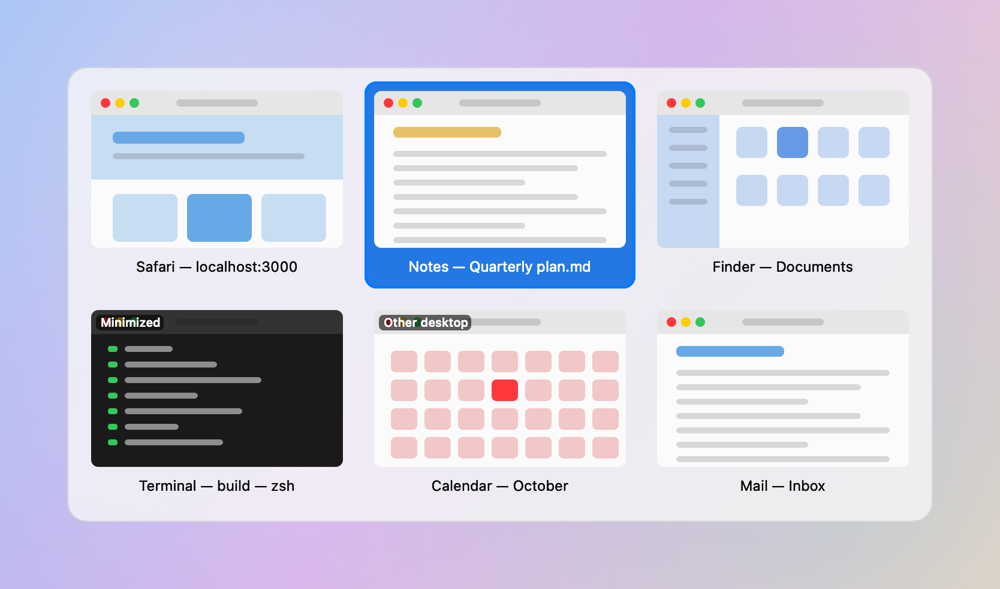
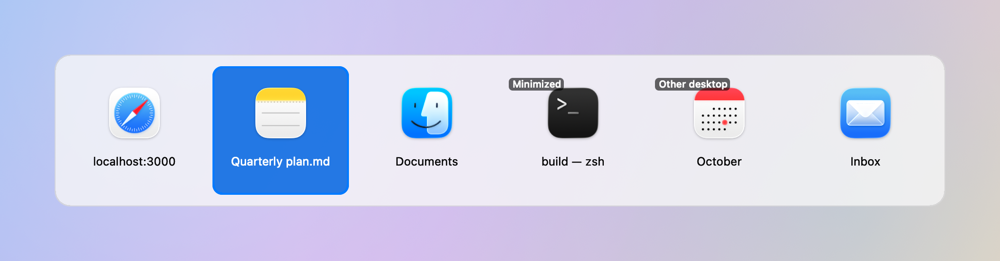

# Tabby

A window switcher for macOS. Hold **Option** and tap **Tab** to see every open window, then let go to jump to the one you picked.

Tabby is a small, private alternative to apps like AltTab. It contains no networking code at all: no update checks, no analytics, no crash reporting. A unit test scans the source and fails the build if any networking API ever appears.

<p align="center">
  <picture>
    <source media="(prefers-color-scheme: dark)" srcset="docs/images/tabby-thumbnails-dark.png">
    
  </picture>
</p>

<p align="center">
  
</p>

*Both images are rendered from made-up windows, not real screenshots.*

## Features

- **Option+Tab** to open, **Tab** / **Shift+Tab** or the arrow keys to move, release **Option** or press **Return** to switch, **Esc** to cancel
- Windows from **every desktop (Space)**, plus **minimized** windows and windows of **hidden** apps
- Most recently used windows first
- Three layouts: **Thumbnails**, **App Icons** (optionally with window titles), and a plain **Titles** list
- The panel sizes itself to fit your windows and appears on the screen with your pointer
- **Mouse support:** click a window to switch to it, click outside the panel to cancel
- **Window controls on hover:** close, minimize, full screen, quit app
- **Live preview:** outlines the selected window where it sits, without moving anything
- A quick tap of Option+Tab switches straight to the previous window without flashing the panel
- **Settings:** layout, thumbnail size, apps to hide, which kinds of windows to show, live preview, launch at login
- Follows light and dark mode

## Requirements

- macOS 14 or later (developed on macOS 26, Apple Silicon)
- Apple's Command Line Tools (Swift 6); full Xcode is not needed

## Permissions

Tabby asks for two permissions on first launch and shows a setup window with buttons to the right System Settings pages.

| Permission | Why |
|---|---|
| **Accessibility** | To see Option+Tab, and to raise, minimize and close windows |
| **Screen Recording** | To draw window thumbnails and read window titles. Without it, Tabby shows app icons instead |

Nothing captured ever leaves your Mac. Thumbnails are kept in memory only, capped at about 64 MB.

## Getting started

1. **Install Apple's Command Line Tools.** Open Terminal and run `xcode-select --install`, then follow the prompts. Full Xcode is not needed.
2. **Create a code-signing certificate, once.** macOS ties permissions to an app's code signature, so an app signed differently on every build would lose its permissions each time you rebuild. A certificate you make yourself keeps the signature stable. In **Keychain Access**, choose **Certificate Assistant > Create a Certificate...**, set **Certificate Type** to **Code Signing**, and give it a name you will remember.
3. **Download and install Tabby.** Run these in Terminal, using your certificate's name:

   ```sh
   git clone https://github.com/masharratt/mac-tabby.git
   cd mac-tabby
   TABBY_SIGN_IDENTITY="Your Certificate Name" scripts/bundle.sh --install
   ```

   `--install` copies the app to `/Applications/Tabby.app` and opens it. Without the flag, the app is left in `build/Tabby.app`. If you use another switcher on Option+Tab, quit it first.
4. **Grant permissions on first launch.** The setup window has buttons to the right pages in System Settings. Turn on **Accessibility** and **Screen Recording** for Tabby. macOS may ask you to reopen Tabby afterwards; say yes.
5. **Use it.** Hold **Option** and tap **Tab**. Keep tapping Tab (or use the arrow keys) to pick a window, then let go of Option to switch.
6. **Optional: start it at login.** Open Tabby's menu bar icon, choose **Settings...**, and turn on **Launch at login**.
7. **Updating and uninstalling.**
   - To update, run `git pull` in the `mac-tabby` folder, then run the same `scripts/bundle.sh --install` command again.
   - To uninstall, choose **Quit Tabby** from its menu bar icon, delete `/Applications/Tabby.app`, and remove Tabby from both the Accessibility and Screen Recording lists in System Settings > Privacy & Security.

## Development

```sh
swift test
```

To regenerate the README images from made-up windows, run `swift build && .build/debug/Tabby --render-demo docs/images`.

## How it works

- The window list comes from ScreenCaptureKit, which is the only public API that sees windows on every desktop. It refreshes in the background, so opening the switcher never waits on it.
- Keyboard and mouse input come from an event tap running on its own thread.
- Switching to a window on another desktop uses a few private macOS (SkyLight) functions. They are all isolated in `Sources/Tabby/PrivateAPI.swift`, looked up when the app starts, and Tabby falls back to public APIs if any are missing. A future macOS update could change them.

## Not affiliated with AltTab

Tabby is an independent project written from scratch. It does not contain code from AltTab or any other switcher.
