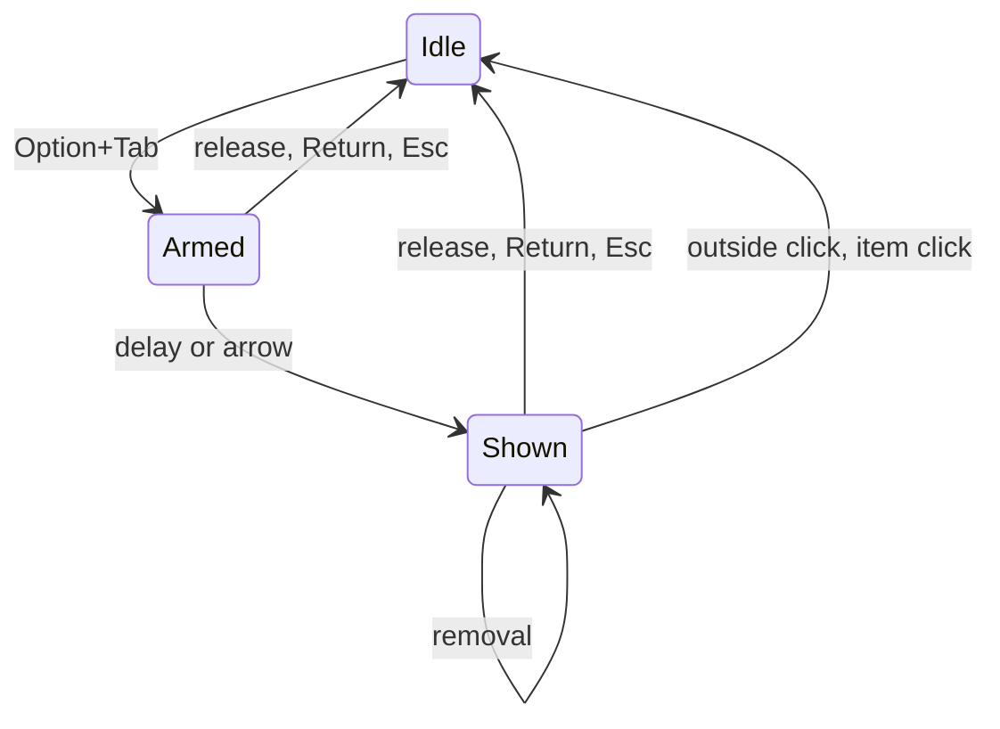
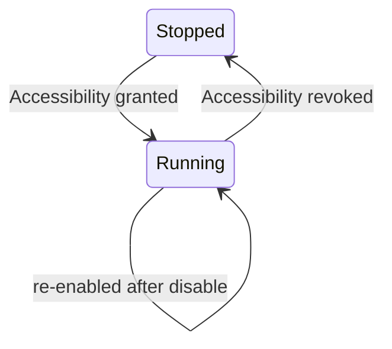
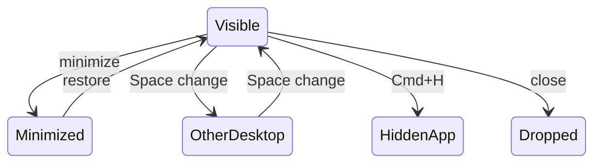
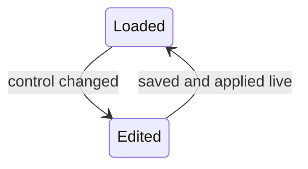
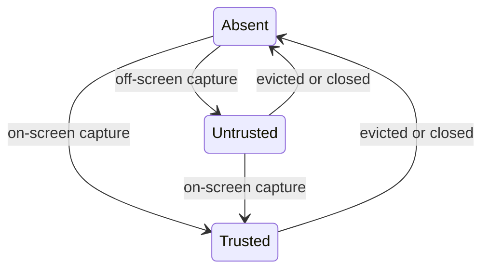

# State Machines

**Last Updated:** 2026-10-15 (stage 3B: mouse events added to Switcher)

## 1. Switcher

**Source:** Sources/TabbyCore/SwitcherStateMachine.swift:44

### States

| State | Meaning |
|-------|---------|
| Idle | Switcher closed. Every key passes through except a swallowed Tab key-up. |
| Armed | Option+Tab seen; panel not visible yet. A quick tap commits from here. |
| Shown | Panel visible. |

### Transitions

| From | To | Trigger | Guard |
|------|----|---------|-------|
| Idle | Armed | Option+Tab or Option+Shift+Tab | At least one window; no Command or Control held; secure input off |
| Idle | Idle | Option+Tab | Zero windows (key still swallowed) |
| Armed | Shown | Tick | Show delay elapsed (default 100 ms) |
| Armed | Shown | Arrow key | None |
| Armed | Armed | Tab | None (selection moves) |
| Shown | Shown | Tab or arrow key | None (selection moves, wraps) |
| Armed | Idle | Option released or Return | Commits the selection |
| Shown | Idle | Option released or Return | Commits the selection |
| Armed | Idle | Esc | Cancels |
| Shown | Idle | Esc | Cancels |
| Shown | Idle | Click outside the panel | Cancels; the click is swallowed |
| Shown | Idle | Click on an item | Commits that item; Option may still be held |
| Shown | Shown | Windows closed or quit from hover controls | List shrinks in place; selection moves to the item that took its place, or the new last item |
| Shown | Idle | Windows closed or quit from hover controls | Nothing left: cancels |
| Armed | Idle | Tap disabled or permission lost | Reset without effects |
| Shown | Idle | Tap disabled or permission lost | Reset without effects |

### Diagram

## 2. Key Tap

**Source:** Sources/Tabby/KeyEventTap.swift:11, Sources/Tabby/AppDelegate.swift (pollPermissions)

### States

| State | Meaning |
|-------|---------|
| Stopped | No tap exists. Accessibility not granted, or revoked. |
| Running | Tap installed and enabled on its own thread. |

### Transitions

| From | To | Trigger | Guard |
|------|----|---------|-------|
| Stopped | Running | Permission poll (every 1 s) | Accessibility granted and tap creation succeeds |
| Running | Stopped | Permission poll | Accessibility revoked |
| Running | Running | System disables the tap (timeout or user input) | Tap is re-enabled and the switcher resets to Idle |

### Diagram

## 3. Window Placement

**Source:** Sources/TabbyCore/WindowInventoryRules.swift (merge)

### States

| State | Meaning |
|-------|---------|
| Visible | On screen in the current Space. No tag. |
| Minimized | Off screen and Accessibility reports it minimized. Tagged "Minimized". |
| Hidden app | Off screen and its app is hidden. No tag. |
| Other desktop | Off screen, not minimized, app not hidden. Tagged "Other desktop". |
| Dropped | Not listed: wrong layer, under 40 px, non-regular app, Tabby itself, or untitled off-screen. |

### Transitions

| From | To | Trigger | Guard |
|------|----|---------|-------|
| Visible | Minimized | Inventory refresh | Off screen and AX minimized for that window id |
| Visible | Other desktop | Inventory refresh (Space change) | Off screen, not minimized, app not hidden |
| Visible | Hidden app | Inventory refresh (Cmd+H) | Off screen and app hidden |
| Minimized | Visible | Inventory refresh | On screen again |
| Other desktop | Visible | Inventory refresh (Space change) | On screen |
| Any | Dropped | Window closes | Absent from the next ScreenCaptureKit list |

### Diagram

## 4. Settings

**Source:** Sources/Tabby/SettingsWindow.swift (SettingsModel), Sources/TabbyCore/Settings.swift

### States

| State | Meaning |
|-------|---------|
| Loaded | Settings read from UserDefaults at launch; bad or missing data gives defaults. |
| Edited | A control in the settings window changed a value. Transient: saves and applies at once. |

### Transitions

| From | To | Trigger | Guard |
|------|----|---------|-------|
| Loaded | Edited | Any control changed | Value differs from the current one |
| Edited | Loaded | Save to UserDefaults, then push to window inventory and switcher engine | None (no relaunch needed) |

### Diagram

## 5. Thumbnail Entry

**Source:** Sources/TabbyCore/ThumbnailCache.swift, Sources/Tabby/ThumbnailStore.swift

### States

| State | Meaning |
|-------|---------|
| Absent | No cached image for the window; the panel shows the app icon. |
| Untrusted | Image captured while the window went off-screen; shown, but any trusted capture replaces it. |
| Trusted | Image captured while the window stayed on-screen. Never replaced by an untrusted capture. |

### Transitions

| From | To | Trigger | Guard |
|------|----|---------|-------|
| Absent | Trusted | Capture lands | Window on-screen before and after; fits the 64 MB budget |
| Absent | Untrusted | Capture lands | Window off-screen after capture; fits the budget |
| Untrusted | Trusted | Capture lands | On-screen before and after |
| Trusted | Trusted | Capture lands | On-screen before and after |
| Trusted | Trusted | Untrusted capture lands | Rejected, old image kept |
| Trusted | Absent | Least recently used and budget exceeded | Another image needs the room |
| Untrusted | Absent | Least recently used and budget exceeded | Another image needs the room |
| Trusted | Absent | Window closes | Inventory refresh no longer lists it |
| Untrusted | Absent | Window closes | Inventory refresh no longer lists it |

### Diagram

