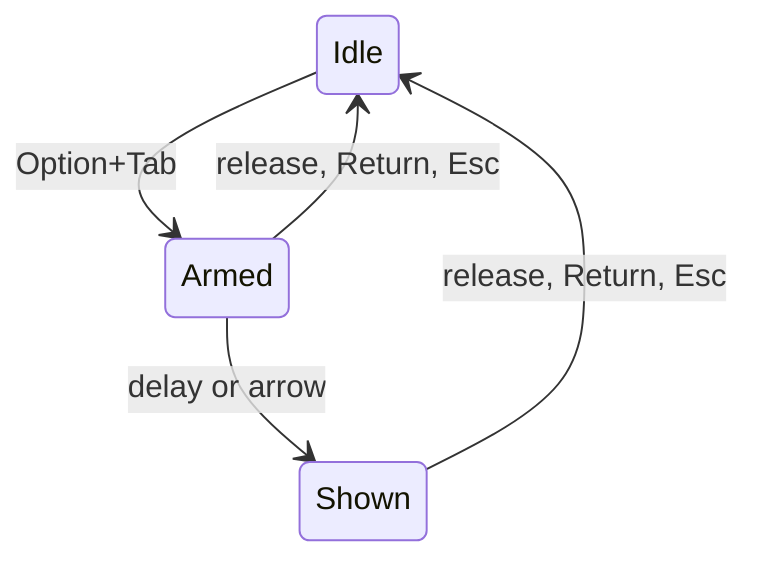
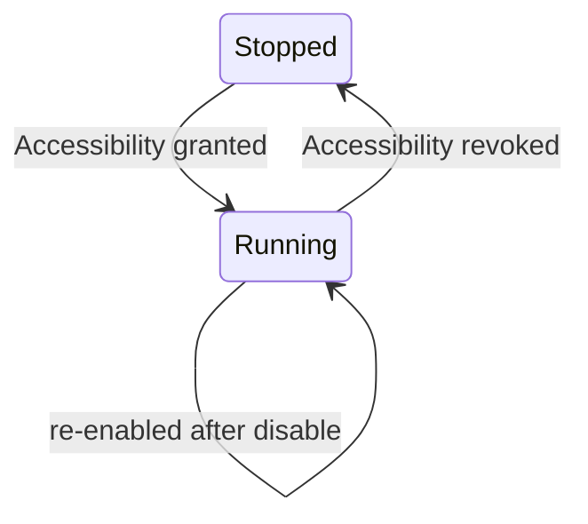

# State Machines

**Last Updated:** 2026-10-15 (phase 1: switcher and key tap)

## 1. Switcher

**Source:** Sources/TabbyCore/SwitcherStateMachine.swift:44

### States

| State | Meaning |
|-------|---------|
| Idle | Switcher closed. Every key passes through except a swallowed Tab key-up. |
| Armed | Option+Tab seen; panel not visible yet. A quick tap commits from here. |
| Shown | Panel visible. |

### Transitions

| From | To | Trigger | Guard |
|------|----|---------|-------|
| Idle | Armed | Option+Tab or Option+Shift+Tab | At least one window; no Command or Control held; secure input off |
| Idle | Idle | Option+Tab | Zero windows (key still swallowed) |
| Armed | Shown | Tick | Show delay elapsed (default 100 ms) |
| Armed | Shown | Arrow key | None |
| Armed | Armed | Tab | None (selection moves) |
| Shown | Shown | Tab or arrow key | None (selection moves, wraps) |
| Armed | Idle | Option released or Return | Commits the selection |
| Shown | Idle | Option released or Return | Commits the selection |
| Armed | Idle | Esc | Cancels |
| Shown | Idle | Esc | Cancels |
| Armed | Idle | Tap disabled or permission lost | Reset without effects |
| Shown | Idle | Tap disabled or permission lost | Reset without effects |

### Diagram

## 2. Key Tap

**Source:** Sources/Tabby/KeyEventTap.swift:11, Sources/Tabby/AppDelegate.swift (pollPermissions)

### States

| State | Meaning |
|-------|---------|
| Stopped | No tap exists. Accessibility not granted, or revoked. |
| Running | Tap installed and enabled on its own thread. |

### Transitions

| From | To | Trigger | Guard |
|------|----|---------|-------|
| Stopped | Running | Permission poll (every 1 s) | Accessibility granted and tap creation succeeds |
| Running | Stopped | Permission poll | Accessibility revoked |
| Running | Running | System disables the tap (timeout or user input) | Tap is re-enabled and the switcher resets to Idle |

### Diagram

